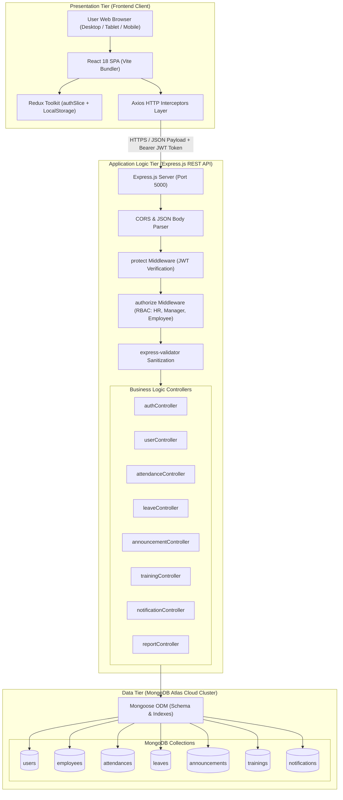
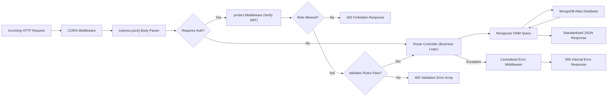
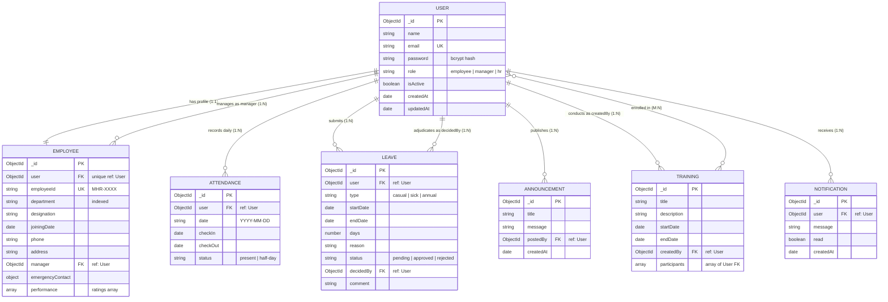
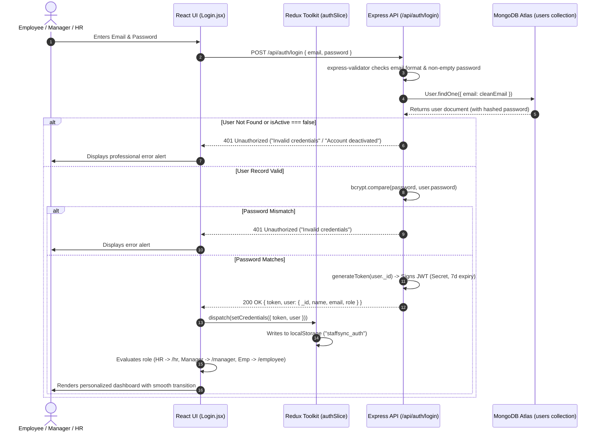
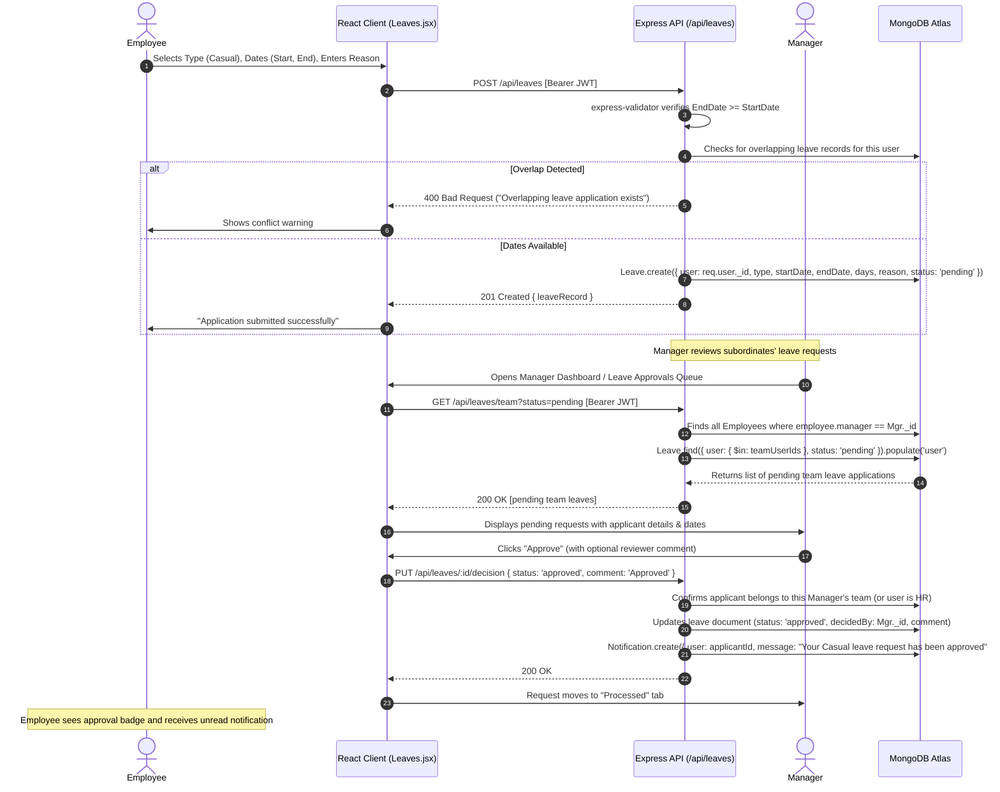
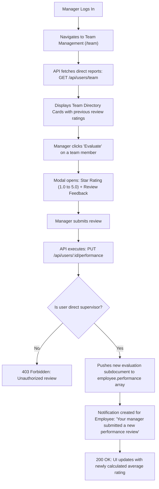
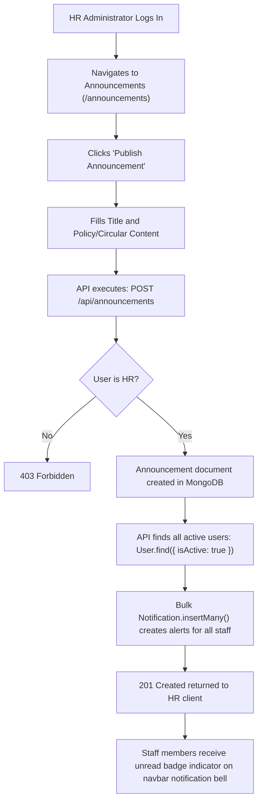
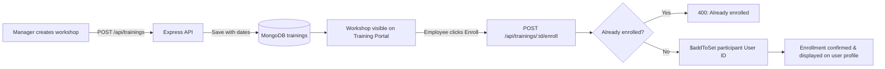

# Modern HR — Complete System Architecture, Workflow & Technical Specification

> **All-In-One Enterprise Reference Document**  
> **Project Name:** Modern HR  
> **Architecture Pattern:** Decoupled 3-Tier Client-Server Architecture (MERN Stack)  
> **Target Audience:** Evaluators, Professors, Technical Leads, and Developers  

---

## Table of Contents
1. [Project Overview & Business Objectives](#1-project-overview--business-objectives)
2. [Technology Stack & Architectural Rationale](#2-technology-stack--architectural-rationale)
   - [Frontend Technologies & Justification](#21-frontend-technologies--justification)
   - [Backend Technologies & Justification](#22-backend-technologies--justification)
   - [Database & Storage Layer](#23-database--storage-layer)
   - [Development & Build Tooling](#24-development--build-tooling)
3. [System Architecture Diagram](#3-system-architecture-diagram)
   - [High-Level 3-Tier Architecture](#31-high-level-3-tier-architecture)
   - [Backend Modular Architecture (MVC + Service Layer)](#32-backend-modular-architecture-mvc--service-layer)
   - [Request-Response Lifecycle & Middleware Pipeline](#33-request-response-lifecycle--middleware-pipeline)
4. [Database Design & Data Models (MongoDB Atlas)](#4-database-design--data-models-mongodb-atlas)
   - [Data Modeling Strategy (Relational References in NoSQL)](#41-data-modeling-strategy)
   - [Entity-Relationship (ER) Diagram](#42-entity-relationship-er-diagram)
   - [Complete Schema & Collection Specifications](#43-complete-schema--collection-specifications)
5. [Complete System Workflows (Sequence & Flow Diagrams)](#5-complete-system-workflows)
   - [Workflow 1: User Authentication & JWT Session Security](#51-workflow-1-user-authentication--jwt-session-security)
   - [Workflow 2: Daily Attendance Lifecycle (Check-in & Check-out)](#52-workflow-2-daily-attendance-lifecycle)
   - [Workflow 3: Leave Management & Managerial Adjudication](#53-workflow-3-leave-management--managerial-adjudication)
   - [Workflow 4: Employee Performance Review by Managers](#54-workflow-4-employee-performance-review-by-managers)
   - [Workflow 5: Corporate Circular Publishing & Notifications](#55-workflow-5-corporate-circular-publishing--notifications)
   - [Workflow 6: Training Workshop Enrollment](#56-workflow-6-training-workshop-enrollment)
   - [Workflow 7: Executive Analytics & Aggregation Reporting](#57-workflow-7-executive-analytics--aggregation-reporting)
6. [Role-Based Access Control (RBAC) Security Matrix](#6-role-based-access-control-rbac-security-matrix)
7. [REST API Endpoints Specification](#7-rest-api-endpoints-specification)
8. [Corporate Personnel Seed Data & Credentials](#8-corporate-personnel-seed-data--credentials)
9. [Viva & Project Defense Q&A Guide](#9-viva--project-defense-qa-guide)
10. [Local Setup & Verification Guide](#10-local-setup--verification-guide)

---

## 1. Project Overview & Business Objectives

**Modern HR** is an enterprise-grade Human Resource Management System (HRMS) developed to centralize and automate core corporate workforce operations. It bridges communication gaps among staff members, managerial supervisors, and executive HR personnel through three dedicated, role-specific portals:

1. **Employee Self-Service Portal**:
   - Single-click daily attendance marking (check-in and check-out) with timestamp audit.
   - Leave application submission with automatic clash detection and remaining balance calculation.
   - Company announcements bulletin board and skill cohort / workshop enrollment.
   - Personal profile governance (emergency contacts, residential address, contact number).

2. **Manager Supervisory Portal**:
   - Direct-report workforce supervision (inspecting designations, departments, employee IDs).
   - Real-time team attendance auditing (viewing daily turnout of subordinates).
   - Leave adjudication engine (approving or rejecting requests with reviewer notes).
   - Performance evaluation module (submitting 1-to-5 star quantitative ratings and qualitative feedback).
   - Technical workshop creation with automatic notification dispatch to assigned team members.

3. **HR Administrative Directorate**:
   - Complete employee lifecycle management (account provisioning, role changes, department transfers, deactivations, deletions).
   - Organization-wide attendance ledger with multi-parameter date filtering.
   - Global leave adjudication and policy compliance auditing.
   - Company circular publishing broadcasted system-wide.
   - Real-time aggregation metrics: Departmental headcount distribution, attendance percentages, and leave status splits.

---

## 2. Technology Stack & Architectural Rationale

This project uses the **MERN** technology stack (MongoDB Atlas, Express.js, React 18, Node.js), chosen for high throughput, unified JavaScript/JSON ecosystem, and rapid asynchronous I/O.

### 2.1 Frontend Technologies & Justification

| Technology | Version | Architectural Role | Why It Was Chosen |
| :--- | :--- | :--- | :--- |
| **React.js** | `^18.3.1` | UI Library | Component-driven architecture, virtual DOM for instant UI re-rendering, and declarative hooks (`useState`, `useEffect`, `useMemo`). |
| **Vite** | `^5.4.8` | Next-Gen Bundler | Provides near-instant Hot Module Replacement (HMR) powered by native ES modules, compiling 10x faster than traditional Webpack setups. |
| **React Router** | `^6.26.2` | Client-Side Routing | Enables Single Page Application (SPA) navigation without page reloads, using `ProtectedRoute` wrappers for RBAC redirection. |
| **Redux Toolkit** | `^2.2.8` | Global State Store | Predictable state container for authentication session persistence (`user`, `token`, `isAuthenticated`), synchronizing with `localStorage`. |
| **Axios** | `^1.7.7` | HTTP Client | Request/Response interceptors: Automatically attaches the JWT `Authorization: Bearer <token>` header to all outgoing requests and catches `401 Unauthorized` responses to trigger clean session termination. |
| **Bootstrap & React-Bootstrap** | `^5.3.3` | UI Layout System | Highly responsive 12-column grid system, accessible dialog modals, tables, badges, and progress bars. |
| **Vanilla CSS Design System** | Custom | UI Styling | Professional Zinc/Slate eye-comforting palette, custom soft badges, card shadows, and smooth page transition animations. Eliminates harsh, unstyled AI looks. |
| **Lucide React / Native SVGs** | Clean SVGs | Iconography | Lightweight vector graphics replacing childish emojis, maintaining enterprise credibility. |

### 2.2 Backend Technologies & Justification

| Technology | Version | Architectural Role | Why It Was Chosen |
| :--- | :--- | :--- | :--- |
| **Node.js** | `>= 18.0.0` | Server Runtime | Non-blocking, event-driven I/O model based on the V8 engine, ideal for handling simultaneous concurrent API requests. |
| **Express.js** | `^5.3.0` | Web Application Framework | Lightweight, un-opinionated routing and middleware architecture, facilitating clean RESTful API endpoint segregation. |
| **Mongoose ODM** | `^9.11.4` | Object Data Modeling | Strict schema validation, pre-save cryptographic hooks, compound database indexes, and relational document population (`ref` / `populate`). |
| **JSON Web Tokens (JWT)** | `^9.0.3` | Stateless Authentication | Cryptographically signed, stateless session tokens (HMAC-SHA256) with a 7-day expiration time. Eliminates server-side session memory overhead. |
| **Bcrypt.js** | `^3.0.3` | Password Hashing | One-way adaptive hashing algorithm utilizing salt rounds (cost factor = 10) to guard against rainbow table and brute-force attacks. |
| **Express-Validator** | `^7.3.2` | Request Validation | Sanitizes inputs and validates constraints (e.g., email format, password complexity, date bounds) before business logic execution. |
| **CORS** | `^2.8.5` | Cross-Origin Security | Configured with explicit origin allowances (`http://localhost:5173`) and HTTP credential transmission. |
| **Dotenv** | `^17.4.3` | Environment Config | Separates runtime configuration (ports, database URIs, secret keys) from source code, complying with 12-Factor App methodology. |

### 2.3 Database & Storage Layer

| Technology | Role | Justification |
| :--- | :--- | :--- |
| **MongoDB Atlas** | Cloud NoSQL Database | Distributed cloud document store providing high availability, auto-scaling, automatic replica sets, and flexible JSON-like BSON documents. |
| **Mongoose Schemas** | Schema Enforcement | Enforces strict data types, field requirements, default values, and compound unique indexes over schemaless MongoDB collections. |

### 2.4 Development & Build Tooling

- **Nodemon**: Auto-restarts backend during development upon detecting code changes.
- **Concurrently**: Runs client and server processes concurrently from the root script if required.

---

## 3. System Architecture Diagram

### 3.1 High-Level 3-Tier Architecture



---

### 3.2 Backend Modular Architecture (MVC + Service Layer)

The backend follows the standard **Model-View-Controller (MVC)** architectural pattern, where the "View" is replaced by JSON responses consumed by the React client:

```
server/
├── src/
│   ├── config/
│   │   └── db.js               # MongoDB connection lifecycle & error event listeners
│   ├── models/                 # Mongoose Data Schemas & Model Definitions
│   │   ├── User.js             # Core authentication identity & role
│   │   ├── Employee.js         # HR metadata, manager relations, ratings
│   │   ├── Attendance.js       # Daily check-in/out timestamps & unique indexes
│   │   ├── Leave.js            # Leave applications & approval metadata
│   │   ├── Announcement.js     # Company circulars
│   │   ├── Training.js         # Technical workshops & participant arrays
│   │   └── Notification.js     # Targeted alert messages
│   ├── middleware/             # Reusable Request Interceptors
│   │   ├── auth.js             # protect (JWT verification) & authorize (RBAC guard)
│   │   ├── validate.js         # express-validator evaluation handler
│   │   └── error.js            # Global centralized error handler & 404 catcher
│   ├── controllers/            # Controller Functions (Business Logic execution)
│   │   ├── authController.js
│   │   ├── userController.js
│   │   ├── attendanceController.js
│   │   ├── leaveController.js
│   │   ├── announcementController.js
│   │   ├── trainingController.js
│   │   ├── notificationController.js
│   │   └── reportController.js
│   ├── routes/                 # Express Router endpoint definitions
│   │   ├── authRoutes.js
│   │   ├── userRoutes.js
│   │   ├── attendanceRoutes.js
│   │   ├── leaveRoutes.js
│   │   ├── announcementRoutes.js
│   │   ├── trainingRoutes.js
│   │   ├── notificationRoutes.js
│   │   ├── reportRoutes.js
│   │   └── dashboardRoutes.js
│   ├── utils/
│   │   └── generateToken.js    # JWT generation utility
│   ├── seed.js                 # Realistic corporate database seeder
│   ├── app.js                  # Express app composition & middleware registration
│   └── server.js               # HTTP server bootstrap & port listening
```

---

### 3.3 Request-Response Lifecycle & Middleware Pipeline

Every HTTP request to the API undergoes a strict pipeline:



---

## 4. Database Design & Data Models (MongoDB Atlas)

### 4.1 Data Modeling Strategy

Although MongoDB is a NoSQL document database, enterprise HR operations require relational integrity (e.g., an Employee belongs to a User, a Manager supervises an Employee, a Leave request is linked to an Employee and decided by a Manager).

**Modern HR utilizes a Normalized Reference Strategy (`ObjectId` with `ref`):**
- Documents reference each other via 24-character hex `Mongoose.Schema.Types.ObjectId`.
- Mongoose's `.populate()` executes internal `$lookup` joins dynamically when data is read.
- Fast lookups and uniqueness are guaranteed through compound BSON database indexes.

---

### 4.2 Entity-Relationship (ER) Diagram



---

### 4.3 Complete Schema & Collection Specifications

#### 1. `users` Collection
Stores authentication credentials and high-level role authorizations.
- `_id` (`ObjectId`, Primary Key): Auto-generated unique identifier.
- `name` (`String`, Required, Trimmed): User's legal full name.
- `email` (`String`, Required, Unique, Lowercase, Trimmed): Login identifier. Indexed uniquely to prevent duplicate registrations.
- `password` (`String`, Required): Bcrypt one-way hash with salt rounds = 10. Automatically removed from JSON outputs via schema `transform` for security.
- `role` (`String`, Enum: `['employee', 'manager', 'hr']`, Default: `'employee'`): Controls RBAC authorization.
- `isActive` (`Boolean`, Default: `true`): Deactivated users are blocked from logging in.
- `createdAt` / `updatedAt` (`Date`): Managed automatically by `{ timestamps: true }`.

#### 2. `employees` Collection
Stores HR-specific metadata, hierarchical reporting mappings, and performance reviews.
- `_id` (`ObjectId`, Primary Key).
- `user` (`ObjectId`, Required, Unique, Ref: `User`): 1-to-1 relationship with the `User` identity.
- `employeeId` (`String`, Required, Unique): Formatted company identifier (e.g., `MHR-1001`).
- `department` (`String`, Required, Indexed): Corporate division (e.g., `Engineering`, `Sales & Growth`, `Human Resources`).
- `designation` (`String`, Required): Job title (e.g., `Senior Software Engineer`).
- `joiningDate` (`Date`, Default: `Date.now`): Official onboarding date.
- `phone` (`String`, Default: `''`): Employee contact line.
- `address` (`String`, Default: `''`): Residential address.
- `manager` (`ObjectId`, Nullable, Ref: `User`): Points to the employee's direct reporting supervisor.
- `emergencyContact` (`Subdocument`): `{ name: String, phone: String }`.
- `performance` (`Array of Subdocuments`):
  - `rating`: Number between 1.0 and 5.0.
  - `note`: Qualitative managerial review comments.
  - `by`: `ObjectId` (Ref: `User`) of the evaluating manager.
  - `date`: Timestamp of evaluation.

#### 3. `attendances` Collection
Records daily check-in and check-out timestamps.
- `_id` (`ObjectId`, Primary Key).
- `user` (`ObjectId`, Required, Ref: `User`): Identity of the employee.
- `date` (`String`, Required, Format: `YYYY-MM-DD`): Local calendar date string.
- `checkIn` (`Date`): Exact ISO timestamp of arrival.
- `checkOut` (`Date`): Exact ISO timestamp of departure.
- `status` (`String`, Enum: `['present', 'half-day']`, Default: `'present'`).
- **Compound Unique Index**: `{ user: 1, date: 1 }` — Strict database-level guarantee preventing an employee from creating multiple check-in documents on the same calendar day.

#### 4. `leaves` Collection
Handles employee time-off requests and managerial decisions.
- `_id` (`ObjectId`, Primary Key).
- `user` (`ObjectId`, Required, Ref: `User`): Applying staff member.
- `type` (`String`, Enum: `['casual', 'sick', 'annual']`, Required): Category of absence.
- `startDate` (`Date`, Required): First day of leave.
- `endDate` (`Date`, Required): Final day of leave.
- `days` (`Number`, Required): Computed working duration.
- `reason` (`String`, Required): Text justification.
- `status` (`String`, Enum: `['pending', 'approved', 'rejected']`, Default: `'pending'`).
- `decidedBy` (`ObjectId`, Nullable, Ref: `User`): Manager or HR admin who approved/rejected the request.
- `comment` (`String`): Review remarks.
- **Compound Index**: `{ user: 1, status: 1 }` for high-speed queries on pending balances.

#### 5. `announcements` Collection
Stores company-wide circulars published by HR.
- `_id` (`ObjectId`, Primary Key).
- `title` (`String`, Required): Headline of circular.
- `message` (`String`, Required): Body text.
- `postedBy` (`ObjectId`, Required, Ref: `User`): HR administrator identity.
- **Index**: `{ createdAt: -1 }` for reverse chronological feed display.

#### 6. `trainings` Collection
Stores skill-building cohorts and workshops.
- `_id` (`ObjectId`, Primary Key).
- `title` (`String`, Required): Training program title.
- `description` (`String`, Required): Objectives and syllabus.
- `startDate` / `endDate` (`Date`, Required): Workshop duration.
- `createdBy` (`ObjectId`, Required, Ref: `User`): Manager hosting the session.
- `participants` (`Array of ObjectId`, Ref: `User`): Enrolled staff members.

#### 7. `notifications` Collection
Stores targeted system alerts for user actions.
- `_id` (`ObjectId`, Primary Key).
- `user` (`ObjectId`, Required, Ref: `User`): Target recipient.
- `message` (`String`, Required): Alert message content.
- `read` (`Boolean`, Default: `false`): Unread status for notification badges.
- **Compound Index**: `{ user: 1, read: 1 }` for fetching unread alerts in sub-millisecond time.

---

## 5. Complete System Workflows

### 5.1 Workflow 1: User Authentication & JWT Session Security



---

### 5.2 Workflow 2: Daily Attendance Lifecycle

```mermaid
sequenceDiagram
    autonumber
    actor Emp as Staff Member
    participant UI as Attendance.jsx
    participant API as Express API (/api/attendance)
    participant DB as MongoDB Atlas (attendances collection)

    Emp->>UI: Navigates to Attendance page
    UI->>API: GET /api/attendance/today [Bearer JWT]
    API->>DB: Attendance.findOne({ user: req.user._id, date: todayDateString })
    DB-->>API: Record status (Null OR Checked In OR Completed)
    API-->>UI: 200 OK { attendance: record }
    UI->>Emp: Renders interactive state (Ready to Check In / Checked In / Completed)

    alt Action: Check In
        Emp->>UI: Clicks "Check In Now"
        UI->>API: POST /api/attendance/check-in [Bearer JWT]
        API->>DB: Attendance.findOne({ user: req.user._id, date: todayDateString })
        alt Duplicate Check-In Attempt
            API-->>UI: 400 Bad Request ("Already checked in for today")
        else First Check-In
            API->>DB: Attendance.create({ user: req.user._id, date: today, checkIn: new Date(), status: 'present' })
            DB-->>API: New Attendance Document
            API-->>UI: 201 Created { checkIn timestamp }
            UI->>Emp: UI transitions to green "Checked In" status with active timer
        end
    else Action: Check Out
        Emp->>UI: Clicks "Check Out"
        UI->>API: PUT /api/attendance/check-out [Bearer JWT]
        API->>DB: Attendance.findOne({ user: req.user._id, date: todayDateString })
        alt Valid Check-In found with checkOut == null
            API->>DB: record.checkOut = new Date(); record.save()
            API-->>UI: 200 OK { checkOut timestamp }
            UI->>Emp: UI displays "Attendance Completed for Today" badge
        else Not Checked In or Already Checked Out
            API-->>UI: 400 Bad Request
        end
    end
```

---

### 5.3 Workflow 3: Leave Management & Managerial Adjudication



---

### 5.4 Workflow 4: Employee Performance Review by Managers



---

### 5.5 Workflow 5: Corporate Circular Publishing & Notifications



---

### 5.6 Workflow 6: Training Workshop Enrollment



---

### 5.7 Workflow 7: Executive Analytics & Aggregation Reporting

```mermaid
flowchart TD
    A["HR accesses Reports Dashboard (/reports)"] --> B["API executes: GET /api/reports/summary"]
    B --> C["MongoDB Aggregation Pipeline 1: Departmental Headcount"]
    C -->|"$group by department, count(*)"| D["Headcount Chart Data"]
    B --> E["MongoDB Aggregation Pipeline 2: Leave Status Distribution"]
    E -->|"$group by status, count(*)"| F["Leave Breakdown Data"]
    B --> G["MongoDB Query 3: Today's Turnout Ratio"]
    G -->|Attendance.countDocuments(today) / Total Active Employees| H["Turnout Percentage"]
    D & F & H --> I["Consolidated JSON summary returned"]
    I --> J["Rendered as responsive stat cards and progress bars in React"]
```

---

## 6. Role-Based Access Control (RBAC) Security Matrix

| Feature / Resource | Employee | Department Manager | HR Directorate | Security Middleware |
| :--- | :---: | :---: | :---: | :--- |
| **Authentication** (`/login`, `/register`) | Public | Public | Public | Public (Rate-limited, sanitized) |
| **View Own Profile** (`GET /users/profile`) | Allowed | Allowed | Allowed | `protect` (Must possess valid JWT) |
| **Edit Own Contact Info** (`PUT /users/profile`) | Allowed | Allowed | Allowed | `protect` (Restricted to own record) |
| **Mark Daily Attendance** (`POST/PUT /attendance/*`) | Allowed | Allowed | Allowed | `protect` (Locked to `req.user._id`) |
| **View Own Attendance History** (`GET /attendance/my`) | Allowed | Allowed | Allowed | `protect` |
| **View Team Attendance Turnout** (`GET /attendance/team`)| Denied (403)| Own Team Only | All Company Staff | `authorize('manager', 'hr')` |
| **View Company Attendance Ledger** (`GET /attendance`)| Denied (403)| Denied (403) | Full Organization | `authorize('hr')` |
| **Submit Leave Request** (`POST /leaves`) | Allowed | Allowed | Allowed | `protect` + Overlap validation |
| **View Own Leave Applications** (`GET /leaves/my`) | Allowed | Allowed | Allowed | `protect` |
| **Adjudicate Team Leave** (`PUT /leaves/:id/decision`)| Denied (403)| Direct Reports | Full Organization | `authorize('manager', 'hr')` + team check |
| **Staff Directory Management** (`POST/PUT/DELETE /users`)| Denied (403)| Denied (403) | Full CRUD | `authorize('hr')` |
| **Submit Performance Rating** (`PUT /users/:id/perf`) | Denied (403)| Direct Reports | Denied (403) | `authorize('manager')` |
| **Publish Corporate Announcements** (`POST /announcements`)| Read-Only | Read-Only | Full CRUD | `authorize('hr')` |
| **Create Training Programs** (`POST /trainings`) | Read & Enroll| Full CRUD | Full Read | `authorize('manager')` |
| **Executive Reports & Analytics** (`GET /reports/summary`)| Denied (403)| Denied (403) | Allowed | `authorize('hr')` |

---

## 7. REST API Endpoints Specification

### Authentication & Profile Endpoints
| HTTP Method | Route URL | Allowed Roles | Request Body Parameters | Response Summary |
| :--- | :--- | :--- | :--- | :--- |
| `POST` | `/api/auth/register` | Public | `{ name, email, password }` | Registers user (forced employee role) & returns JWT |
| `POST` | `/api/auth/login` | Public | `{ email, password }` | Authenticates credentials & returns `{ token, user }` |
| `GET` | `/api/auth/me` | Authenticated | *None* | Returns active user session profile |
| `GET` | `/api/users/profile` | Authenticated | *None* | Returns populated employee & manager info |
| `PUT` | `/api/users/profile` | Authenticated | `{ phone, address, emergencyContact }` | Updates personal contact details |

### Attendance Endpoints
| HTTP Method | Route URL | Allowed Roles | Request Body Parameters | Response Summary |
| :--- | :--- | :--- | :--- | :--- |
| `POST` | `/api/attendance/check-in` | Authenticated | *None* | Creates today's check-in timestamp |
| `PUT` | `/api/attendance/check-out` | Authenticated | *None* | Stamps departure time on today's record |
| `GET` | `/api/attendance/today` | Authenticated | *None* | Returns today's check-in/out status |
| `GET` | `/api/attendance/my?page=` | Authenticated | *Query params* | Paginated personal attendance history |
| `GET` | `/api/attendance/team?date=` | Manager, HR | `date` (YYYY-MM-DD) | Subordinate turnout on specified date |
| `GET` | `/api/attendance?date=&page=` | HR | `date`, `page` | Organization-wide attendance ledger |

### Leave Management Endpoints
| HTTP Method | Route URL | Allowed Roles | Request Body Parameters | Response Summary |
| :--- | :--- | :--- | :--- | :--- |
| `POST` | `/api/leaves` | Authenticated | `{ type, startDate, endDate, reason }` | Submits new leave application |
| `GET` | `/api/leaves/my` | Authenticated | *None* | Returns personal leaves & balance stats |
| `GET` | `/api/leaves/team?status=` | Manager, HR | `status` (pending/approved/all) | Returns direct reports' leave requests |
| `GET` | `/api/leaves?status=&page=` | HR | `status`, `page` | All company-wide leave records |
| `PUT` | `/api/leaves/:id/decision` | Manager, HR | `{ status: 'approved'/'rejected', comment }` | Adjudicates leave application |

### Workforce Governance & Performance Endpoints
| HTTP Method | Route URL | Allowed Roles | Request Body Parameters | Response Summary |
| :--- | :--- | :--- | :--- | :--- |
| `GET` | `/api/users?role=&dept=&search=` | HR | Multi-filter query params | Paginated employee directory |
| `POST` | `/api/users` | HR | `{ name, email, password, role, department, designation, manager }` | Provisions new staff account |
| `PUT` | `/api/users/:id` | HR | Profile update fields | Updates staff profile / toggles active status |
| `DELETE` | `/api/users/:id` | HR | *None* | Permanently removes staff member |
| `GET` | `/api/users/managers` | HR | *None* | Dropdown list of all managers |
| `GET` | `/api/users/team` | Manager | *None* | Direct subordinates list with ratings |
| `PUT` | `/api/users/:id/performance` | Manager | `{ rating: 1-5, note: string }` | Submits formal evaluation |

### Circulars, Training & Analytics Endpoints
| HTTP Method | Route URL | Allowed Roles | Request Body Parameters | Response Summary |
| :--- | :--- | :--- | :--- | :--- |
| `GET` | `/api/announcements` | Authenticated | `page` | Paginated circulars feed |
| `POST` | `/api/announcements` | HR | `{ title, message }` | Broadcasts circular & triggers alerts |
| `PUT` / `DELETE` | `/api/announcements/:id` | HR | Circular fields | Edits or archives announcement |
| `GET` | `/api/trainings` | Authenticated | *None* | Active workshops directory |
| `POST` | `/api/trainings` | Manager | `{ title, description, startDate, endDate }` | Creates training program |
| `POST` | `/api/trainings/:id/enroll` | Authenticated | *None* | Enrolls employee in workshop |
| `GET` | `/api/notifications` | Authenticated | *None* | Returns user's unread alert notifications |
| `PUT` | `/api/notifications/read-all` | Authenticated | *None* | Clears unread alert badges |
| `GET` | `/api/reports/summary` | HR | *None* | Aggregated metrics & distributions |
| `GET` | `/api/dashboard` | Authenticated | *None* | Role-tailored home dashboard stats |

---

## 8. Corporate Personnel Seed Data & Credentials

The live database on MongoDB Atlas is populated with real enterprise personas across all three tiers.

> **Universal Password for all accounts:**  
> `Password@123`

| Tier / Role | Personnel Name | Corporate Email Address | Department | Designation / Scope |
| :--- | :--- | :--- | :--- | :--- |
| **HR Directorate** | **Priya Sharma** | `hr@modernhr.com` | Human Resources | Chief HR Officer / System Administrator |
| **Engineering Lead** | **Vikram Malhotra** | `manager1@modernhr.com` | Engineering | Vice President of Engineering |
| **Sales Lead** | **Ananya Deshmukh** | `manager2@modernhr.com` | Sales & Growth | Head of Enterprise Sales |
| **Employee 1** | **Rohan Verma** | `emp1@modernhr.com` | Engineering | Senior Full-Stack Engineer (Reports to Vikram) |
| **Employee 2** | **Neha Gupta** | `emp2@modernhr.com` | Engineering | QA Automation Lead (Reports to Vikram) |
| **Employee 3** | **Arjun Mehta** | `emp3@modernhr.com` | Engineering | Cloud Systems Architect (Reports to Vikram) |
| **Employee 4** | **Kavita Reddy** | `emp4@modernhr.com` | Sales & Growth | Strategic Account Executive (Reports to Ananya) |
| **Employee 5** | **Aditya Rao** | `emp5@modernhr.com` | Sales & Growth | Senior Business Analyst (Reports to Ananya) |

---

## 9. Viva & Project Defense Q&A Guide

When presenting this project to teachers or evaluators, review these common architectural and conceptual questions:

### Q1: Why did you choose MongoDB instead of MySQL or PostgreSQL?
> **Answer**:  
> MongoDB provides a dynamic, flexible document structure (BSON) that maps cleanly to JavaScript JSON objects in Node and React. HR data structures often feature nested subdocuments—such as performance rating histories and emergency contact objects—which in a relational SQL database would require multiple joined tables and complex foreign key migrations. In MongoDB, these are embedded natively or linked via ObjectIds with Mongoose schema validation, compound indexing, and high read/write performance.

### Q2: How is authentication handled, and how does the server know which user is making a request?
> **Answer**:  
> Authentication is stateless using **JSON Web Tokens (JWT)**:
> 1. When a user submits valid credentials, the server signs a token using an HMAC-SHA256 secret key containing the user's MongoDB `_id` and role payload.
> 2. The client stores this token in Redux and `localStorage`.
> 3. An Axios interceptor automatically attaches this token in the HTTP `Authorization: Bearer <token>` header for subsequent requests.
> 4. The backend `protect` middleware decodes and verifies the token signature, fetches the active user record from the database, and attaches it to `req.user`.

### Q3: How do you prevent security vulnerabilities like SQL Injection or NoSQL Injection?
> **Answer**:  
> 1. **NoSQL Injection**: Express-validator explicitly checks data types (ensuring strings are strings rather than malicious `$gt` or `$ne` query operator objects). Mongoose schemas strictly cast inputs into typed primitives.
> 2. **Password Exposure**: Passwords are never stored in plaintext; they are hashed with **bcryptjs** using 10 salt rounds. Furthermore, Mongoose's `toJSON` schema transform strips the `password` field from all outgoing JSON responses.
> 3. **Role Spoofing**: Public registration endpoints strictly hardcode `role: 'employee'`. Administrative and managerial roles can only be granted by an authenticated HR Administrator via protected endpoints.

### Q4: How is Role-Based Access Control (RBAC) enforced?
> **Answer**:  
> Through a two-stage middleware pipeline:
> - `protect`: Verifies that the client is authenticated and holds a valid, non-expired JWT.
> - `authorize('hr', 'manager')`: Checks whether `req.user.role` matches the permitted roles for that specific endpoint. If unauthorized, it immediately terminates the request with `403 Forbidden` before any business logic or database queries execute.

### Q5: How do you prevent an employee from marking attendance twice on the same day?
> **Answer**:  
> We enforce this at two layers:
> 1. **Application Logic**: The controller checks `Attendance.findOne({ user: req.user._id, date: todayDateString })` and returns `400 Bad Request` if a check-in record already exists.
> 2. **Database Constraint**: A compound unique index `{ user: 1, date: 1 }` exists on the MongoDB collection, making it physically impossible for duplicate records to be inserted.

---

## 10. Local Setup & Verification Guide

### Prerequisites
- Node.js version 18 or higher installed
- Web browser (Chrome, Edge, Firefox, or Safari)
- Internet connection (to communicate with the MongoDB Atlas cloud cluster)

### 1. Start Backend API (`server/`)
```bash
cd "c:\Users\Gulab Jangid\Desktop\Modern Hr\server"
npm install
npm run seed       # Populates realistic corporate test personas into MongoDB Atlas
npm run dev        # Starts Express server on http://localhost:5000
```
*Health Check URL*: `http://localhost:5000/api/health` (should return `{"status":"ok"}`)

### 2. Start Frontend Client (`client/`)
```bash
cd "c:\Users\Gulab Jangid\Desktop\Modern Hr\client"
npm install
npm run dev        # Starts Vite dev server on http://localhost:5173
```
*Application URL*: Open `http://localhost:5173/` in your browser.

### 3. Recommended Demonstration Path for Evaluators
1. **Login as HR (`hr@modernhr.com`)**:
   - Inspect the executive dashboard with real-time employee counts and attendance ratios.
   - Open **Staff Directory** to demonstrate employee creation, role editing, and manager assignment.
   - Open **Reports & Analytics** to show departmental breakdowns and leave distribution graphs.
   - Publish a company announcement on the **Announcements** page.
2. **Login as Manager (`manager1@modernhr.com`)**:
   - Inspect direct subordinates on the **Team Management** page.
   - Submit a 5-star performance rating with review comments for Rohan Verma.
   - Inspect daily team attendance turnout.
   - Review and approve pending leave requests.
3. **Login as Employee (`emp1@modernhr.com`)**:
   - Mark daily attendance with the **Check In** button.
   - Apply for a casual or sick leave and check remaining leave balances.
   - Read the company circular published by HR.
   - Open the notification bell to view real-time alerts.
